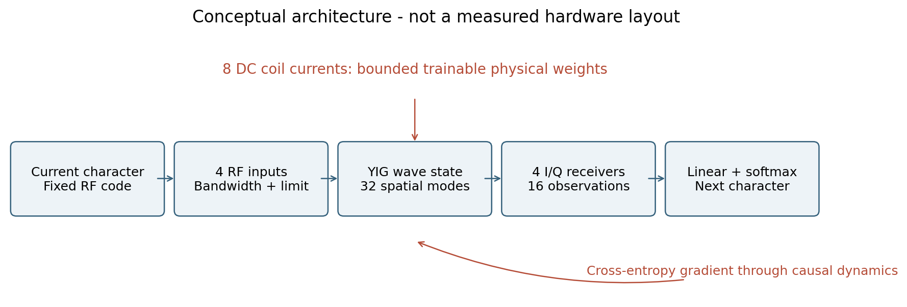

# YIG Magnonic Language Model MVP

要求仕様 `codex_magnonic_lm_mvp_prompt.md` に基づく、本チャット専用の研究実装。YIGを想定する空間的縮約波動モデル、局所DCコイル電流の内部Weight学習、同じ線形Readoutの固定Reservoir比較、実データの文字LM、validationだけを用いるポート配置の逆設計を実行する。

**これは実機実証やSpinTorch論文の完全再現ではない。** 独自のuniform厚み・周期1D・弱非線形縮約モデルである。実際の測定結果は `results/aggregate/metrics.json` と最終報告 `docs/RESULTS_JA.md` に置く。報告がまだ無ければ実行/監査が進行中である。

## 読む順序

1. `docs/DECISIONS.md`: なぜYIG、局所コイル、縮約モデル、線形Readoutを選んだか。
2. `docs/THEORY_AUDIT.md`: LLGからの式、コードとの対応、原著との相違、近似、各関数の理由。
3. `src/magnonic/config.py` → `physics.py` → `models.py` → `data.py` → `training.py`: 実装。
4. `configs/protocol_v1.json`: 総予算・Seed・分割・停止条件。
5. `docs/EXPERIMENTAL_FEASIBILITY.md`、`LIMITATIONS.md`、`REFERENCES.md`、`REPRODUCIBILITY.md`。
6. `docs/RESULTS_JA.md`: 実計算の結論と日本語解説。



## LMをブラウザで試す

[LM Labを開く](https://spinlanguage-lm-lab-rei.rrui49851.chatgpt.site)（所有者本人のみアクセスできるページ）。

`ui/` に学習済みcheckpointを使う生成UIがあります。内部Weight学習・固定Reservoir・記憶なし・小GRU、各3 Seedから選び、英字の書き出しから続きを生成できます。Temperature、文字数、Top-k、生成Seedを調整し、固定版との比較、停止、コピー、設定付きJSON保存ができます。推論はブラウザCPUのWeb Workerで動き、入力文をサーバーへ送信しません。

```sh
python3 -m http.server 8765 --bind 127.0.0.1 --directory ui
# http://127.0.0.1:8765/ を開く
node tests/browser_inference.mjs
```

ブラウザ版は元checkpointの重みを使用する数値推論です。実機YIGでの動作は未検証です。語彙はTiny Shakespeareの65文字なので、日本語入力には対応しません。研究のCEは32文字windowでの評価で、UIの連続生成品質を保証する値ではありません。

モデルファイルとPython比較fixtureを再出力する場合:

```sh
PYTHONPATH=src .venv/bin/python scripts/export_browser_models.py
```

## Python環境とテスト

Python 3.12を推奨。CPUでもforwardと物理テストは動く。GPU本学習はPyTorch CUDAを使う。

```sh
python3.12 -m venv .venv
.venv/bin/python -m pip install numpy==1.26.4 pytest==9.1.1
# Linux A100, CUDA 12.4 wheel:
.venv/bin/python -m pip install torch==2.5.1 --index-url https://download.pytorch.org/whl/cu124
# Mac/CPUの場合は通常のPyPIからtorch==2.5.1をインストール
PYTHONPATH=src .venv/bin/python -m pytest -q
```

実行時の全依存versionは結果の環境ログに保存する。GPUの既存共有環境を更新するコマンドではない。最小forwardは次のとおり。

```python
import torch
from magnonic.config import PhysicsConfig
from magnonic.models import PhysicalLanguageModel
model = PhysicalLanguageModel(65, PhysicsConfig(), seed=11, variant="trained")
logits, physical_state = model(torch.tensor([[1, 2, 3]]))
print(logits.shape)  # (batch=1, time=3, vocabulary=65)
```

## データ

```sh
python scripts/audit_sources.py
python scripts/software_audit.py
python scripts/build_reference_notes.py
```

`audit_sources.py` は論文レジストリの書誌を取得し、Tiny Shakespeareを原配布から取得する。これらのsource監査はネットワークが必要。Tiny Shakespeareの配布license欄は明示不足なので、研究での取得を記録し、再配布licenseを決めつけない。合成Delayed Recallは `data.recall_batch` がSeed付きで生成する。

## 慶應AICで2台実行

今回の証拠は `results/setup.log`、`results/preflight-*`、`results/study-*` にある。GPU数は1台/worker、最大同時2件、各ジョブの論理device 0を使う。Slurmの物理割当を固定しない。アカウントQoSの同時上限2台を確認済み。

```sh
# 初回のみ。新しい環境を作り、既存環境は変更しない。
python scripts/aic_setup.py
python scripts/aic_run.py --phase preflight
# gateを確認してから実行。今回のv1実験はすでに投入済み。
python scripts/aic_run.py --phase study
```

**既存runの確認なしにstudyを再実行しない。** source digest・job ID・squeue/sacctを照合する。`aic_setup.py` は既存の専用ディレクトリがあると停止する。新規再現実験には独立したREMOTE名とversioned protocolを使う。SSH接続は既存keyのパスだけを参照し、BatchMode/IdentitiesOnly/StrictHostKeyCheckingを有効にする。秘密鍵の内容を保存しない。

`/share` と計算ノード `/tmp` が満杯だったため `/dev/shm` に本タスクだけの依存/ソース/出力を置き、完了runをMacへ転送した。RAM上の保存だけを永続backupと扱わない。各更新でstatevectorを保存せず、scalar curveとbest/last checkpointを保存する。

## 評価と図の再生成

```sh
PYTHONPATH=src .venv/bin/python scripts/diagnostics.py --study results/study-20261014-061533
python scripts/count_baselines.py
# matplotlibが入った解析環境で:
python scripts/postprocess.py --study results/study-20261014-061533
python scripts/plot_waveforms.py
python scripts/plot_concept.py
```

`postprocess.py` は実JSON/CSVを集計し、平均/Seed標準偏差・学習曲線・遅延別正解率・ノイズ感度・Weight分布を描く。`diagnostics.py` はbest checkpointをCPUで読んで少数のmode waveformと追加感度試験を行う。全状態をReadoutへ渡す操作ではない。

checkpointにはmodel/physical config/Seed/最良validation stepを保存する。`last.pt` にはoptimizerとRNGもある。再開の自動再投入は実装せず、現存ジョブと結果を確認してから行う。

保存モデルでCPU自由生成を再実行する例:

```sh
PYTHONPATH=src .venv/bin/python scripts/generate_checkpoint.py \
  --checkpoint results/study-20261014-061533/worker-1/results/lm-seed-11-trained/best.pt \
  --variant trained --device cpu --characters 400
```

## ファイル構成

| 場所 | 内容 |
|---|---|
| src/magnonic | 物理、観測、データ、Readout、学習、optional calibration |
| tests | 単位、減衰、伝搬、勾配、因果性、分割、paired initialization |
| scripts | 文献/ソフト監査、AIC実行、結果集計、checkpoint再計算 |
| configs | 事前に固定した科学的予算と停止条件 |
| results | GPU証拠、実計算JSON/CSV/checkpoint、生成文字、図 |
| docs | 日本語理論監査、設計選定、実験可能性、限界、再現性、結果 |
| third_party | 私用の原著PDF/HTML/公式ソース監査コピー、Gitでは除外 |

主モデルの追加内部パラメータは8コイルだけ。Readoutを大きいMLPへ変更して物理モデルの不足を隠さない。得られた結果が悪くても同じ固定予算の結果として公開する。
